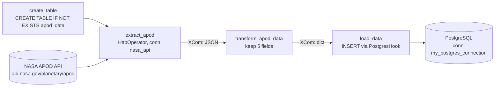

# NASA APOD ETL Pipeline

An Apache Airflow pipeline that pulls NASA's Astronomy Picture of the Day (APOD) every day and stores it in PostgreSQL, built as a compact end-to-end example of an orchestrated ETL job.

## Overview

NASA publishes one astronomy image or video per day, with a title and an explanation, through its public APOD API. This project schedules a daily Airflow DAG that creates the target table if needed, calls the API, keeps the fields worth storing, and inserts one row per run into PostgreSQL. It runs locally on the Astronomer Astro Runtime in Docker, and the API key is read from an Airflow connection rather than from code.

## Highlights

- One DAG, `nasa_apod_postgres` (`dags/etl.py`), scheduled `@daily` with `catchup=False`.
- Four tasks mixing classic and TaskFlow styles: `create_table` (PostgresHook), `extract_apod` (HttpOperator, `GET planetary/apod`), and `transform_apod_data` and `load_data` (`@task`).
- Data moves between tasks through XCom, and the insert uses a parameterized query.
- Target table `apod_data` with columns `id`, `title`, `explanation`, `url`, `date`, `media_type`.
- Astro Runtime 12.2.0 base image (`Dockerfile`), with the Postgres provider listed in `requirements.txt`.

## Architecture



## Tech stack

Python, Apache Airflow (TaskFlow API, HTTP and Postgres providers), Astronomer Astro CLI and Runtime 12.2.0, PostgreSQL, Docker.

## Quickstart

Requires Docker and the [Astro CLI](https://www.astronomer.io/docs/astro/cli/install-cli).

```bash
astro dev start   # Airflow UI at http://localhost:8080 (login admin / admin)
```

In the Airflow UI, under Admin > Connections, create the two connections the DAG expects:

| Connection ID | Type | Settings |
|---|---|---|
| `nasa_api` | HTTP | Host `https://api.nasa.gov/`, Extra `{"api_key": "<your NASA API key>"}` |
| `my_postgres_connection` | Postgres | Any reachable Postgres. For a local test, the Postgres container that Astro starts works: host `postgres`, port `5432`, login and password `postgres` |

A free API key is available at api.nasa.gov. Then unpause and trigger `nasa_apod_postgres`, and check the stored rows:

```bash
astro dev bash --postgres
psql -U postgres -c "SELECT date, title, media_type FROM apod_data;"
```

## Project structure

```
dags/etl.py                     the nasa_apod_postgres DAG
Dockerfile                      Astro Runtime 12.2.0 base image
requirements.txt                Airflow Postgres provider
docker-compose.yml              optional standalone Postgres 13 container (see limitations)
tests/dags/test_dag_example.py  Astro example DAG tests
.astro/                         Astro CLI project config and DAG parse test
```

## Limitations and next steps

- Each run inserts a new row with no uniqueness check on `date`, so re-running a day creates duplicates. An upsert keyed on `date` would fix it.
- `docker-compose.yml` is not valid as written: it mounts a `postgres_data` volume that is never declared, and it is not on the Astro network. Declaring the volume and moving the service into `docker-compose.override.yml` would make it usable.
- The bundled example tests require DAG tags and `retries >= 2`, which the DAG does not set yet, so `astro dev pytest` fails until both are added.
- `start_date` is computed from the current day, and `requirements.txt` lists an unpinned `apache-airflow` on top of the runtime image. A fixed start date and removing that line would make runs more predictable.

## License

No license specified yet.
